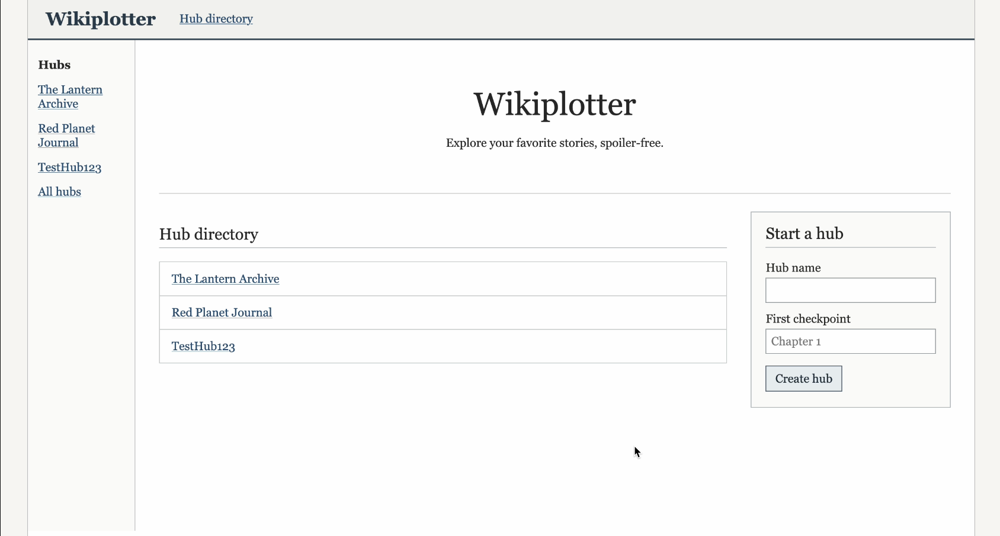

# Wikiplotter

Wikiplotter is a spoiler-aware wiki for narrative fiction. Each series has a hub with an ordered set of reading checkpoints. Readers record their progress, while contributors organize articles into versioned content blocks and assign checkpoint requirements to articles, titles, text, and images. The intended experience is a wiki that reveals information as the reader advances, based on contributors' spoiler classifications.

**A reader's journey:** Bob finishes chapter 50 and visits the series hub to look up an artifact mentioned earlier in the series. As this is his first time visiting, before he is allowed to view any pages, he is prompted to select his latest completed chapter. The site refreshes and he can now browse all the articles and content available up to that point in the story. Whether browsing or reading an article, any later revelations remain hidden, including any revealing article titles or passages. When Bob reaches chapter 70, he can update his progress at the click of a button and the site will refresh with newly available information up until that point. There's no stress involved with navigating vague spoiler warnings.

After reaching chapter 90, Bob learned new lore about the artifact, but found that the relevant information wasn't updated on the article page. Since he's been using Wikiplotter for a while now, he thinks it's worthwhile to finally create an account. "Log in" redirects him to use a Google or Commons account to access the wiki, and to register his username as a new user. The progress from his browsing session up to Chapter 90 as a guest is automatically updated to his new account. He quickly finds the article page and clicks on the edit button. Bob decides to append a block about the artifact, setting the checkpoint to Chapter 90. He also thinks an image of the updated form of the artifact would fit well here, so he uploads it directly in the editor as another block after the explanation, and saves the edits. The article updates, and the site refreshes for Bob, reflecting the changes. 

### Beta 
See all current features in [BETA.md](./docs/decisions/BETA.md).

The project is being built incrementally with TypeScript, Bun, sync-engine **1.1.0**, and MongoDB.

### Demo 
**Click the thumbnail below!**
<p align="center">
  <a href="https://drive.google.com/file/d/1YOJrL5zgmGN7S9tEPsCWyqzui64yi_4r/view" target="_blank" rel="noopener noreferrer">
    
  </a>
</p>

## Getting Started

### Installation

Install [Bun 1.x](https://bun.sh) and ensure MongoDB is available locally.

```sh
bun install
bun run db:up
```

### Environment Setup

Create the environment files from their templates:

```sh
cp .env.example .env
cp .env.test.example .env.test.local
cp .env.production.example .env.production.local
```

Configure matching MongoDB credentials and ports across all three files. Each environment uses a separate database:

| Environment | Database | Configuration |
|---|---|---|
| Development | `wikiplotter_dev` | `.env` |
| Testing | `wikiplotter_test_*` | `.env.test.local` |
| Production | `wikiplotter` | `.env.production.local` |

Database names are validated against `WIKIPLOTTER_ENV` to prevent cross-environment access.

### Running the Application

**Development** (backend and frontend):

```sh
bun run dev
```

**Production:**

```sh
bun run generate
bun run check
bun run start
```

Populate demonstration content using the local fixture workflow before serving reader content.

### Testing & Notes

- Run tests with `bun run test` and project checks with `bun run check`.
- Tests use isolated, disposable MongoDB databases.
- Concept, composition, and persistence tests verify individual operations, workflows, and database durability.
- MongoDB credentials are initialized when the database volume is first created; changing environment files does not update existing credentials.
- See `package.json` for additional commands and configuration.

## Project layout

| Location | Purpose |
| --- | --- |
| `docs/decisions/` | Architectural decisions and rationale between iterations. |
| `design/concepts/` | Independent concept specifications. |
| `design/compositions/` | Application workflows and endpoint contracts. |
| `design/types.md` | Concept instances and application type bindings. |
| `src/concepts/`, `src/concepts.ts` | Concept implementations, registrations, and the application concept set. |
| `src/compositions/` | Executable composition declarations. |
| `src/assembly.ts` | Reader and local setup assembly construction. |
| `src/main.ts`, `src/db.ts` | Backend startup and MongoDB connection. |
| `frontend/` | Vue application. |
| `scripts/` | Local fixture creation through the gateway. |
| `tests/` | Concept, composition, and persistence tests. |
| `generated.config.ts`, `generated.reader.config.ts`, `generated/` | Setup and reader design-check configurations and generated contracts. |

---

## Disclaimer

**AI assistance:** This README and portions of the project design were generated or revised with AI assistance. Generated material requires review and testing; this documentation is not evidence that the application has been fully implemented or verified.
